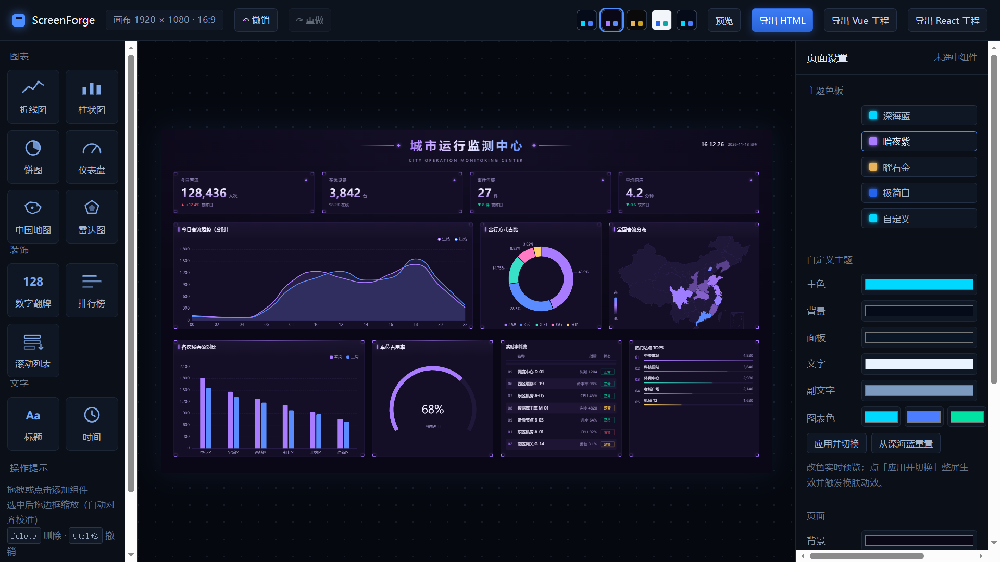

# ScreenForge · 开源大屏搭建器

拖拽 ECharts 搭大屏 → 改主题 → 导出**可直接进项目**的 HTML / Vue 工程 / React 工程。

> 状态：V1（内核 + 编辑器 + 三种导出）。接口数据管线、多页面、协作等功能见「路线图」。

## 目录结构

```
screenforge/
├── src/
│   ├── core/                     ★ 框架无关内核
│   │   ├── schema.ts             类型定义（schema 是唯一数据源）
│   │   ├── themes.ts             主题 token / 颜色推导 / 自定义主题
│   │   ├── option.ts             component+data+theme → ECharts option
│   │   ├── renderer.ts           createScreen 命令式渲染器
│   │   ├── materials.ts          物料注册表（新增组件只改这里）
│   │   ├── schema-fields.ts      配置面板字段类型
│   │   ├── initial.ts            初始示例大屏
│   │   ├── runtime-entry.ts      导出 HTML 用的运行时入口（构建为 IIFE）
│   │   └── assets/china.json     中国地图 geoJSON（随包分发）
│   ├── editor/                   ★ React 编辑器
│   │   ├── App.tsx               编排根组件（schema 引用 + 历史 + 渲染同步）
│   │   ├── components/
│   │   │   ├── Topbar.tsx        顶栏：撤销/主题色板/预览/三种导出
│   │   │   ├── Palette.tsx       物料库（拖拽或点击添加）
│   │   │   ├── CanvasStage.tsx   画布：缩放适配 + 拖拽缩放 + 吸附校准
│   │   │   ├── Inspector.tsx     属性面板（字段驱动 + 数据 + rawOption + 图层）
│   │   │   └── Preview.tsx       全屏预览
│   │   └── utils/
│   │       ├── geometry.ts       命中测试 / 缩放 / 吸附算法
│   │       ├── confetti.ts       换肤「撒盐」特效
│   │       └── misc.ts           clone / uid / findComp
│   ├── export/                   ★ 导出
│   │   ├── exportHtml.ts         单文件 HTML（内联 runtime.iife.js）
│   │   ├── project.ts            Vue / React 工程代码生成 + JSZip 打包
│   │   └── runtime.iife.js       构建产物（npm run build:runtime 生成）
│   ├── index.css                 编辑器样式
│   └── main.tsx                  编辑器入口
├── docs/DESIGN.md                详细设计方案（架构 / schema / 里程碑）
├── prototype/                    第一版单文件原型（留档参考）
└── package.json
```

## 开发

```bash
npm install
npm run dev        # 编辑器 → http://localhost:5173
npm run build      # 生产构建（会先构建运行时）
```



> `npm run dev` 会自动执行 `build:runtime`，因为导出 HTML 需要内联 `src/export/runtime.iife.js`。

## 部署与在线预览

**GitHub Pages（推荐，零服务器）**：仓库已带 `.github/workflows/deploy.yml`，推送即自动构建发布：

```bash
git remote add origin https://github.com/<你的用户名>/<仓库名>.git
git push -u origin main
```

首次部署前需在仓库 `Settings → Pages → Source` 选择 **GitHub Actions**（只需一次）。之后每次 push 到 `main`，CI 会自动执行 `build:runtime + vite build`，发布到：

```
https://<你的用户名>.github.io/<仓库名>/
```

> GitHub Pages 项目页部署在 `/<仓库名>/` 子路径下。工作流会自动把仓库名注入 `SF_BASE` 环境变量、由 `vite.config.ts` 读取作为部署 base，避免 JS/CSS 资源 404；本地开发默认 `/`，无需任何配置。

**其他平台**：Vercel / Netlify 无需任何配置文件，导入仓库后构建命令 `npm run build`、产物目录 `dist` 即可（它们部署在根域名，无子路径问题）。


## 已实现能力

```
| 能力 | 说明 |
|---|---|
| 物料库（11 种） | 折线、柱状、饼图、仪表盘、**中国地图**、雷达图、数字翻牌、排行榜、**滚动列表**、标题、时间 |
| 自由布局 | 拖拽移动、8 向缩放、**移动与缩放都有吸附校准线**、方向键微调 |
| 属性面板 | 由物料声明自动生成；rawOption 逃生舱兜底 |
| 数据 | 写死 JSON 编辑 / 随机数据 / 接口配置（V1 仅保存） |
| 主题 | 4 套预设 + 自定义（主色/背景/面板/文字/副文字/5 个图表色），换肤带撒盐特效 |
| 图层 | 置顶置底、锁定、隐藏、复制、删除 |
| 撤销重做 | 60 步快照 |
| 预览 | 全屏 16:9 |
| 导出 | 单文件 HTML（离线可用）/ Vue 3 工程 / React 工程（zip） |
```

## 新增一个物料要做什么

1. 在 `core/materials.ts` 的 `MATERIALS` 里加一条声明（类型、默认尺寸、默认 props/data、面板字段）；
2. 图表类：在 `core/option.ts` 加一个 option 分支；
3. DOM 类：在 `core/renderer.ts` 的 `domHTML()` 加一个分支；
4. 导出支持：在 `export/project.ts` 补 Vue/React 模板（否则导出时该组件会缺失）。

## License

MIT
